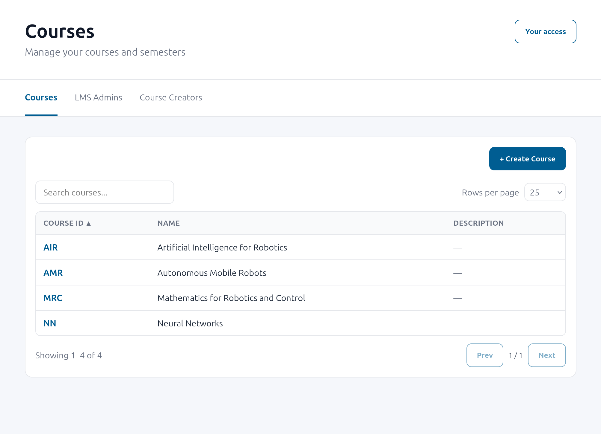
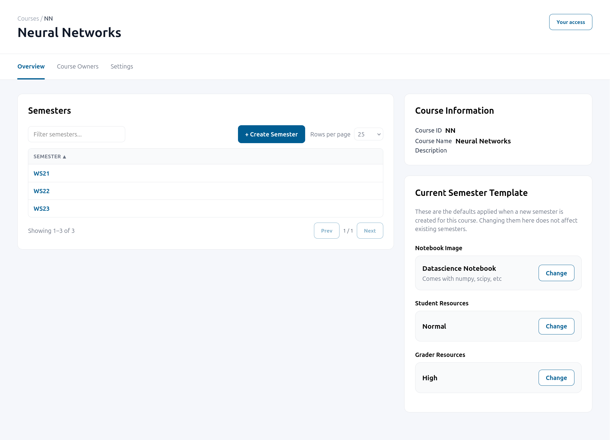

# e2x Course Hub

[](https://github.com/Digiklausur/e2x-course-hub/actions/workflows/ci.yml)
[](https://pypi.org/project/e2x-course-hub/)
[](https://pypi.org/project/e2x-course-hub/)
[](https://e2x-course-hub.readthedocs.io/en/latest/index.html)
[](https://github.com/Digiklausur/e2x-course-hub/blob/main/LICENSE)

**Documentation:** <https://e2x-course-hub.readthedocs.io/en/latest/index.html> ·
**PyPI:** <https://pypi.org/project/e2x-course-hub/>

A JupyterHub service for running multi-course, multi-term teaching deployments. It manages courses, terms, and course membership; enforces who may do what
via role-based access control; and tells a separate infrastructure spawner which
courses/terms a user may launch and with which environment — without ever deciding
hardware itself.

It ships as a FastAPI backend (REST API under `/v1/...`) plus a React single-page app
(`course-service-ui`) for course and membership management, both served from the same
process.



## What it does

- **Course & term management** — courses and their terms are stored in a database
  (SQLAlchemy) and managed through a REST API: create/remove courses and terms, edit
  metadata, and configure the environment (image, resource tier, profile) per course,
  overridable per term.
- **Role-based access control** — powered by [`e2x-hub-rbac`](https://github.com/Digiklausur/e2x-hub-rbac).
  Roles (LMS admin, course creator, course owner, instructor, teaching assistant,
  student, observer) are scoped to the LMS, a course, or a term, and membership is
  backed by JupyterHub groups.
- **A typed contract with the spawner** — `e2x_course_hub.contract` defines the
  boundary between this package and the JupyterHub Spawner that actually launches
  containers. The course hub owns authorization and course configuration; the spawner
  owns the runtime. They meet only through two `Protocol`s:
  - `SpawnOfferingProvider` (implemented here): tells the spawner, for a given user,
    which course/terms they may launch, in which role, with which selection.
  - `InfrastructureCatalogProvider` (implemented by the spawner): tells the course hub
    what images, resource tiers, and profiles actually exist, so course configuration
    can only ever offer valid choices.
- **A management UI** — `course-service-ui`, a React SPA served by the same FastAPI app,
  for browsing courses and managing membership in the browser.

| Semesters and their environment template | What a role may do, right next to its members |
|---|---|
|  |  |

|            | Course hub (this repo)                                              | Infrastructure spawner                            |
|------------|-----------------------------------------------------------------------|----------------------------------------------------|
| Knows      | courses, terms, users, roles (via `e2x-hub-rbac`), permissions        | what can actually be run: image families/tags, resource tiers, profiles |
| Implements | `SpawnOfferingProvider`                                                | `InfrastructureCatalogProvider`                     |
| Consumes   | `InfrastructureCatalogProvider`                                        | `SpawnOfferingProvider`                             |
| Never does | translates a selection to hardware                                    | decides who is allowed to do what                   |

The spawner is a separate, pluggable package, discovered at startup through an entry
point. See [`e2x-course-hub-kubespawner`](https://github.com/DigiKlausur/e2x-course-hub-kubespawner)
for an example implementation based on KubeSpawner, and the
[spawner contract](https://e2x-course-hub.readthedocs.io/en/latest/spawner/contract.html)
for how to write your own.

## Installation

```bash
pip install e2x-course-hub
```

To install the latest development version from GitHub instead:

```bash
pip install git+https://github.com/Digiklausur/e2x-course-hub.git
```

## Getting started

The course service runs as a
[JupyterHub managed service](https://jupyterhub.readthedocs.io/en/stable/reference/services.html).
The [course service guide](https://e2x-course-hub.readthedocs.io/en/latest/course_service/overview.html)
shows the `jupyterhub_config.py` entries, how to choose an infrastructure provider and
how to create the first LMS admin.

## Documentation

- [User guide](https://e2x-course-hub.readthedocs.io/en/latest/user_guide/courses.html) — managing courses, semesters and members in the UI
- [Configuration](https://e2x-course-hub.readthedocs.io/en/latest/reference/configuration.html) — all environment variables
- [REST API](https://e2x-course-hub.readthedocs.io/en/latest/reference/rest_api.html) — routes, actions and errors
- [Roles](https://e2x-course-hub.readthedocs.io/en/latest/reference/roles.html) — what each role may do, and the groups behind them
- [Spawner contract](https://e2x-course-hub.readthedocs.io/en/latest/spawner/contract.html) — for writing an infrastructure spawner

## Development

```bash
git clone https://github.com/Digiklausur/e2x-course-hub
cd e2x-course-hub
pip install -e ".[dev]"
```

Building the package (`pip install .` or `python -m build`) also builds
`course-service-ui` via `hatch-jupyter-builder` and bundles the result into the wheel.
For frontend-only iteration:

```bash
cd course-service-ui
npm install
npm run dev
```

### Architecture

```
e2x_course_hub/
├── contract/           # Protocol boundary shared with the infrastructure spawner
│   └── providers.py       # InfrastructureCatalogProvider, SpawnOfferingProvider
│       # (re-exports the catalog/selection models from schema/ below)
├── schema/              # Pydantic models backing the contract and the API
│   ├── catalog.py         # InfrastructureCatalogOptions and friends
│   ├── selection.py        # SpawnSelection, SpawnOffering, CourseReference
│   ├── course.py           # CourseConfig / TermConfig
│   └── types.py            # SpawnRole, UserLike
├── db/                  # SQLAlchemy models + CourseRepository
├── api/                 # Business logic, framework-agnostic
│   ├── api.py              # API — aggregates the sub-APIs below
│   ├── course_api.py        # Course/term CRUD and environment configuration
│   ├── membership_api.py    # Course membership (extends e2x-hub-rbac's MembershipAPI)
│   ├── infrastructure_api.py # Read-only access to the infrastructure catalog
│   ├── spawn_offering_api.py # Implements SpawnOfferingProvider for the spawner
│   └── *_permissions.py      # Role → permission mappings per sub-API
├── course_service/      # The FastAPI service
│   ├── fastapi_app.py       # App wiring: routers, auth, static files, SPA route
│   ├── settings.py          # ServiceSettings (extends settings.CoreSettings)
│   ├── whoami.py            # Minimal standalone service: returns the caller's identity
│   └── {courses,terms,infrastructure,membership,me,roles}/  # One router + schemas per resource
├── loader.py            # Composition root: settings → concrete API objects
└── settings.py          # CoreSettings: hub API, DB, membership, usernames, infrastructure provider

course-service-ui/       # React 19 + TypeScript SPA, built with Vite
```

### Linting and checks

```bash
ruff check .
ruff format --check .
```

```bash
cd course-service-ui
npm run lint
npm run format
```

`course-service-ui` consumes the REST API with types generated from the OpenAPI schema
(`npm run generate:api-types` in `course-service-ui/`). CI (`.github/workflows/ci.yml`)
runs Python linting, frontend linting/formatting, and checks that the generated OpenAPI
schema and TypeScript types are committed and in sync with the routers.

## License

MIT License — see [LICENSE](https://github.com/Digiklausur/e2x-course-hub/blob/main/LICENSE) for details.
